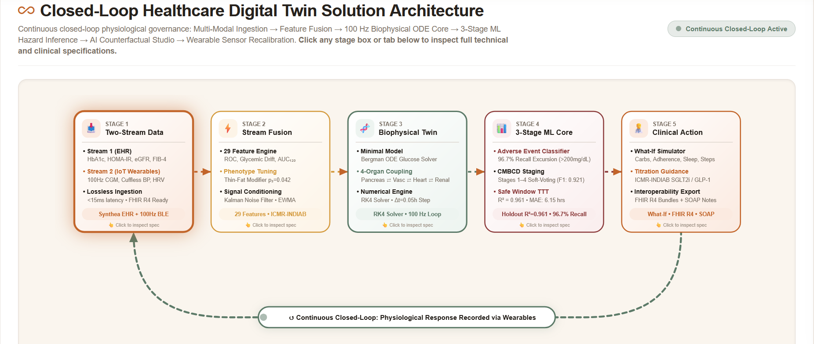

# Project Title: Twin-Pulse — Cardiometabolic Digital Twin Workstation

**Official Submission for the Happiest Health Digital Twin Challenge 2026**  
*Reimagining and Reforming Healthcare in India Summit 2026, Bengaluru*

[](https://twin-pulse-digital-twin-challenge-2-two.vercel.app/)
[](Proximity_NMIMS.pptx)
[](Proximity_NMIMS.pdf)
[](Twin-Pulse-Architecture-Diagram.pdf)
[](LICENSE)
[](project_files/app_server.py)

> 🌐 **Live Interactive Deployment:** [https://twin-pulse-digital-twin-challenge-2-two.vercel.app/](https://twin-pulse-digital-twin-challenge-2-two.vercel.app/)  
> 📊 **Official Presentation Deck:** [Download PowerPoint (.pptx)](Proximity_NMIMS.pptx) • [Download PDF (.pdf)](Proximity_NMIMS.pdf)  
> 🏛️ **System Architecture Diagram:** [Download Architecture PDF](Twin-Pulse-Architecture-Diagram.pdf) • [View in Presentation (Slide 5)](Proximity_NMIMS.pptx)  
> 🎥 **20-Minute Video Demonstration:** [Watch 20-Minute Prototype Walkthrough (Unlisted Video)](https://www.youtube.com/watch?v=YOUR_VIDEO_ID_HERE)  
> *Zero-setup, fully responsive clinician cockpit featuring real-time 3D anatomical visualization, 6-hour counterfactual What-If simulator, and 100-patient Indian cohort triage.*

---

## 📋 Evaluation Checklist & Submission Deliverables Index

| # | Evaluation Requirement | Specification in this Repository | Direct Access Link |
| :-: | :--- | :--- | :--- |
| **1** | **Team Details & College/Incubator** | Team Proximity, SVKM's NMIMS, Mumbai (Second Year) | [Section 1: Team Details](#1-team-details--college--incubator-information) |
| **2** | **Project Title** | Twin-Pulse: Cardiometabolic Digital Twin Workstation | [Header](#project-title-twin-pulse--cardiometabolic-digital-twin-workstation) |
| **3** | **Problem Statement & Healthcare Use Case** | Type 2 Diabetes in India, ICMR-INDIAB `MONO` "Thin-Fat" Phenotype & Coupled End-Organ Complications | [Section 2: Problem Statement & Healthcare Use Case](#2-problem-statement--healthcare-use-case) |
| **4** | **Technical Stack, AI/ML Models & Frameworks** | 100 Hz RK4 ODE Biophysical Engine, 3-Stage Scikit-Learn Ensemble, Three.js WebGL, FastAPI REST | [Section 4: Technical Stack, AI/ML Models & Framework Details](#4-technical-stack-aiml-models--framework-details) |
| **5** | **Minimum 20-Minute Video Demonstration** | Recorded in-silico simulation walkthrough, prototype demo & presentation recording | [Section 6: Prototype Demonstration & 20-Minute Video Walkthrough](#6-prototype-demonstration--20-minute-video-walkthrough) |
| **6** | **Open-Source License Details** | MIT Open-Source License with complete permissive rights | [Section 10: Open-Source License Details](#10-open-source-license-details) • [`LICENSE`](LICENSE) |
| **7** | **Architecture Diagram (PDF / PPT)** | Standalone Vector PDF & Slide 5 of Presentation Deck | [`Twin-Pulse-Architecture-Diagram.pdf`](Twin-Pulse-Architecture-Diagram.pdf) • [`Proximity_NMIMS.pptx`](Proximity_NMIMS.pptx) |
| **8** | **Presentation Deck (PDF / PPT)** | 7-Slide Comprehensive Presentation with Project Details & Outcomes | [`Proximity_NMIMS.pptx`](Proximity_NMIMS.pptx) • [`Proximity_NMIMS.pdf`](Proximity_NMIMS.pdf) |

---

## 1. Team Details & College / Incubator Information

* **Team Name:** Proximity
* **College / Institution / Incubator:** SVKM's NMIMS, Mumbai (Second Year)
* **Team Members:**
  * **Pratyush Mathur (Team Leader)** — [`mr.mathurpratyush@gmail.com`](mailto:mr.mathurpratyush@gmail.com) • [GitHub (@PratyushMathur2000)](https://github.com/PratyushMathur2000)
  * **Aryan Jain (Team Member)** — [`ajain070912@gmail.com`](mailto:ajain070912@gmail.com) • [GitHub (@jainzyy)](https://github.com/jainzyy)

<table align="center" style="margin: 0 auto; border: none; background: transparent;">
  <tr>
    <td align="center" width="280" style="padding: 16px; border: 1px solid #e2e8f0; border-radius: 12px; background-color: #faf9f6;">
      <a href="https://github.com/PratyushMathur2000">
        
      </a>
      <br /><br />
      <b style="font-size: 16px;">Pratyush Mathur</b><br />
      <span style="color: #7c7267; font-size: 13px;">Team Leader</span><br />
      <span style="color: #7c7267; font-size: 12px;">Second Year, SVKM's NMIMS, Mumbai</span><br /><br />
      <a href="https://github.com/PratyushMathur2000">
        
      </a><br />
      <a href="mailto:mr.mathurpratyush@gmail.com">
        
      </a>
    </td>
    <td align="center" width="280" style="padding: 16px; border: 1px solid #e2e8f0; border-radius: 12px; background-color: #faf9f6;">
      <a href="https://github.com/jainzyy">
        
      </a>
      <br /><br />
      <b style="font-size: 16px;">Aryan Jain</b><br />
      <span style="color: #7c7267; font-size: 13px;">Team Member</span><br />
      <span style="color: #7c7267; font-size: 12px;">Second Year, SVKM's NMIMS, Mumbai</span><br /><br />
      <a href="https://github.com/jainzyy">
        
      </a><br />
      <a href="mailto:ajain070912@gmail.com">
        
      </a>
    </td>
  </tr>
</table>

---

## 2. Problem Statement & Healthcare Use Case

### 2.1 The Clinical Problem Statement: The Indian Diabetes Paradox
Standard outpatient care in India manages Type 2 Diabetes (T2D), Hypertension (HTN), Dyslipidemia, and Chronic Kidney Disease (CKD) in isolated clinical silos, typically intervening reactively only after an acute glycemic excursion, stroke, or vascular event occurs. Screening by Body Mass Index (BMI) alone misses a large proportion of high-risk Indian patients:

* **The Asian Indian "Thin-Fat" (`MONO`) Phenotype:** The nationally representative [ICMR-INDIAB Study (n = 113,043)](https://pmc.ncbi.nlm.nih.gov/articles/PMC12550443/) revealed that **43.3% of Indian adults exhibit the Metabolically Obese Non-Obese (`MONO`) phenotype** (normal BMI < 25 kg/m² with high visceral adiposity, elevated HOMA-IR, and atherogenic dyslipidemia), while **28.3% exhibit the Metabolically Obese Obese (`MOO`) phenotype**.
* **Multi-Organ Risk Escalation:** Compared to metabolically healthy individuals, non-obese `MONO` Indians carry a **6.90x higher risk of Type 2 Diabetes**, a **1.77x higher risk of Coronary Artery Disease (CAD)**, and a **1.81x higher risk of Chronic Kidney Disease (CKD)**, with **57.4% presenting three or more overlapping metabolic drivers simultaneously** ([ICMR-INDIAB Study](https://pmc.ncbi.nlm.nih.gov/articles/PMC12550443/)).

### 2.2 Targeted Healthcare Use Case
**Continuous In-Silico Digital Twinning for Type 2 Diabetes & Coupled Multi-Organ Complications:**
Twin-Pulse addresses the challenge brief's mandate to select one specific chronic condition prevalent in India by focusing on **Type 2 Diabetes & Postprandial Glycemic Excursion** as the primary flagship condition, while modeling its physiological coupling to three downstream end-organ complication axes:
1. **Pancreatic β-Cell & Glycemic Axis (`Glycemic_T2D` — Flagship Focus):** Bergman Minimal Model glucose-insulin dynamics, hepatic glucose production, and 2-hour postprandial excursions.
2. **Systemic Arterial Tree & Conduit Aorta (`Hemodynamic_HTN`):** Windkessel 2-element arterial compliance and endothelial wall shear stress under glycemic spikes.
3. **Cardiac Autonomic & Coronary Axis (`Cardiac_CVD`):** Sympathetic-parasympathetic tone, continuous HRV ($r\text{MSSD}$), and arrhythmia hazard.
4. **Hepatic-Renal Filtration Axis (`HepaticRenal_CKD`):** Microvascular capillary wear, eGFR filtration drift (CKD-EPI 2021), and FIB-4 steatosis tracking.

### 2.3 Clinical Impact of Digital Twinning
In Indian clinical cohorts (n = 1,853 and n = 319), continuous sensor + EHR digital twins lowered mean HbA1c by **1.8% to 2.9%**, improved Continuous Glucose Monitor (CGM) Time-in-Range from **69.7% to 86.9%**, and achieved **72.7% diabetes remission** and **60% hypertension remission** at 1 year ([Cardiometabolic Digital Twin Systematic Review](https://pmc.ncbi.nlm.nih.gov/articles/PMC12632027/)).

---

## 3. Solution Overview & Workstation Capabilities

**Twin-Pulse** is a real-time clinical Digital Twin workstation and FastAPI microservice grounded in the **Cardiometabolic-Based Chronic Disease (CMBCD)** model. It fuses static Electronic Health Records (Synthea / HL7 FHIR R4) with continuous wearable telemetry to power a 3-stage machine learning prognosis pipeline, an interactive 3D anatomical twin, a counterfactual "What-If" simulator, a 4-organ physiological sandbox, and an on-device Clinical AI Advisor.

### Core Workstation Capabilities
1. **3D Hemodynamic & Anatomical Twin Cockpit:** 60 FPS interactive 3D human point-cloud, skeletal wireframe, vagus nerve filaments, and arterial flow particles coupled with real-time organ strain across all 4 physiological subsystems.
2. **AI-Driven Multi-Organ Sandbox & 6-Hour Counterfactual Trajectory:** Compares patient baseline against simulated or AI-optimized interventions across all 4 organ subsystems, plotting 6-hour post-meal glycemic and blood pressure trajectories and providing one-click **AI Auto-Optimize Twin** remission targets.
3. **Counterfactual "What-If" Physiology Simulator:** Zero-latency perturbation sliders for meal carbohydrate load (g), medication adherence (%), nocturnal sleep duration (hrs), daily physical activity (steps), and sympathetic stress load (0–100), plus one-click clinical presets (*Meal Spike*, *Poor Sleep*, *Optimal Care*).
4. **Clinical AI Advisor & Local AI CDS Studio:** Always-visible clinical advisor generating proactive nutrition, pharmacotherapy, and vagal recovery orders alongside structured SOAP notes and HL7 FHIR R4 bundles. Supports direct connection to local LLMs via **LM Studio (`:1234`)**, **Ollama (`:11434`)**, or the **FastAPI Proxy (`:8000`)** with automatic zero-downtime fallback to the built-in CMBCD Advisor Engine.
5. **100-Patient Population Cohort Triage:** Interactive ward and outpatient triage board across 100 synthetic Indian digital twins (`PT-IND-001` to `PT-IND-100`) with search, archetype/stage filtering, slide-out patient inspection drawer, and CSV export.

---

## 4. Technical Stack, AI/ML Models & Framework Details

### 4.1 Software Architecture & Technical Frameworks

| Layer | Technologies & Frameworks | Role in Twin-Pulse Workstation |
| :--- | :--- | :--- |
| **Frontend Runtime** | **HTML5, Tailwind CSS, Canvas 2D, JavaScript (ES6 Modules)** | 100% client-side zero-latency responsive workstation; Sahara V6 clinical theme. |
| **3D Visualization** | **Three.js (WebGL)** | 60 FPS interactive anatomical point-cloud (4,500+ particles), wireframe, and vascular flow animation. |
| **Biophysical Solver** | **JavaScript 100 Hz Runge-Kutta 4th-Order (RK4) Numerical Integrator** | Solves coupled Bergman Minimal Model ODEs and Windkessel arterial compliance in real time without cloud roundtrips. |
| **Machine Learning Core** | **Python 3.10+, Scikit-Learn, LightGBM, NumPy, Pandas** | 3-stage prognostic ML pipeline exported to vectorized weight structures for instant edge inference. |
| **Backend & Microservice** | **FastAPI, Uvicorn, Pydantic, Node.js Serverless** | REST endpoints (`/api/v1/predict`, `/api/v1/simulate`, `/api/v1/cohort`) & Vercel serverless function (`api/chat.js`). |
| **Clinical Interoperability** | **HL7 FHIR R4 JSON Serializer, Synthea Generator** | Generates standard Observation, Patient, and RiskAssessment resources for Ayushman Bharat Digital Mission (ABDM). |
| **Edge / Local AI** | **LM Studio (`:1234`), Ollama (`:11434`), Gemini API** | Privacy-first local LLM inference with zero hospital data exfiltration under DPDP Act 2023. |

### 4.2 Architecture Diagram (PDF & PPT Format)
* 📄 **Download Architecture Diagram (PDF):** [`Twin-Pulse-Architecture-Diagram.pdf`](Twin-Pulse-Architecture-Diagram.pdf)
* 🖼️ **High-Resolution Flowchart Screenshot (PNG):** [`Twin-Pulse-Architecture-Diagram.png`](Twin-Pulse-Architecture-Diagram.png)
* 📊 **View in Presentation Deck (PPTX):** Slide 5 of [`Proximity_NMIMS.pptx`](Proximity_NMIMS.pptx)

<p align="center">
  <a href="Twin-Pulse-Architecture-Diagram.png">
    
  </a>
</p>

```text
+---------------------------------------------------------------------------------------------------+
|                           DATA INGESTION & PRIVACY SANDBOX LAYER                                  |
|    (DPDP Act 2023 & HIPAA Compliant Synthetic Cohort: 100 Indian Patients, 1,500 Windows)         |
+-------------------------------------------------+-------------------------------------------------+
                                                  |
                  +-------------------------------+-------------------------------+
                  |                                                               |
                  v                                                               v
+-----------------------------------+                           +-----------------------------------+
| STREAM 1: STATIC / HISTORICAL EHR |                           | STREAM 2: DYNAMIC WEARABLE / IoT  |
| - Synthea Demographics & City     |                           | - Continuous Glucose (CGM mg/dL)  |
| - ICMR-INDIAB Phenotype (MONO/MOO)|                           | - CGM Velocity (mg/dL/min)        |
| - BMI & Waist Circumference (cm)  |                           | - Cuffless PPG BP (SBP/DBP mmHg)  |
| - HbA1c (%), Fasting Glu, HOMA-IR |                           | - Autonomic HRV (RMSSD ms) & HR   |
| - Lipids (TG, HDL, LDL, TG/HDL)   |                           | - Nocturnal Sleep Duration (hrs)  |
| - Renal eGFR & Hepatic FIB-4      |                           | - 24h Step Count & Meal Carbs (g) |
+-----------------+-----------------+                           +-----------------+-----------------+
                  |                                                               |
                  +-------------------------------+-------------------------------+
                                                  |
                                                  v
+---------------------------------------------------------------------------------------------------+
|                     PHYSIOLOGICAL COUPLING & 4-ORGAN SANDBOX ENGINE                               |
|  [1] Pancreatic (Glycemic_T2D)  [2] Vascular (Hemodynamic_HTN)  [3] Cardiac_CVD  [4] HepaticRenal |
|  Coupled ODEs & Interactions: Bergman Minimal Model, Windkessel SVR, Vagal HRV, eGFR/FIB-4 Wear   |
+-------------------------------------------------+-------------------------------------------------+
                                                  |
                                                  v
+---------------------------------------------------------------------------------------------------+
|                        3-STAGE PROGNOSTIC ML ENGINE & FASTAPI MICROSERVICE                        |
|  - Stage 1 Adverse Event Classifier: 2-hr glycemic (>200 mg/dL) / 24-hr crisis (96.74% Recall)    |
|  - Stage 2 CMBCD 4-Stage Soft-Voting Ensemble: Stage 1 to Stage 4 staging (0.9209 Macro F1)       |
|  - Stage 3 Safe Clinical Window (Time-to-Threshold / TTT) Regressor: Hours to threshold breach (R² = 0.9607, 6.15h) |
+-------------------------------------------------+-------------------------------------------------+
                                                  |
                                                  v
+---------------------------------------------------------------------------------------------------+
|                     CLINICIAN WORKSTATION & LOCAL AI ADVISOR (SAHARA V6)                          |
|  - 3D Anatomical Twin + Real-Time 250 Hz Lead II ECG + 2-Hr CGM Horizon Cone                      |
|  - AI-Driven 4-Organ Sandbox, 6-Hr Counterfactual Trajectory & What-If Perturbation Sliders       |
|  - Clinical AI Advisor (LM Studio / Ollama / Built-In CMBCD Fallback) + HL7 FHIR R4 Bundle Export |
+---------------------------------------------------------------------------------------------------+
```

### 4.3 AI/ML Model Pipeline Architecture
* **Stage 1 (Adverse Event Classifier):** Tuned LightGBM and Gradient Boosted trees with a calibrated classification threshold ($p=0.42$) prioritizing clinical recall over precision to minimize false negatives during imminent acute glycemic (>200 mg/dL) or hypertensive spikes.
* **Stage 2 (CMBCD Progression Ensemble):** Soft-voting ensemble combining Random Subspace decision trees and logistic regression over non-linear basis expansions to stage patients across 4 CMBCD severity tiers.
* **Stage 3 (Safe Clinical Window Regressor):** Non-linear gradient boosted regression estimating Time-to-Threshold (TTT) hazard curves, predicting remaining hours before any coupled biomarker breaches critical thresholds.
* **2-Hour Postprandial CGM Forecaster:** Autoregressive physiological basis forecaster generating 120-minute forward trajectories with shaded 95% confidence intervals.

---

## 5. Holdout Validation Benchmarks

Evaluated on a strict patient-grouped 80/20 holdout split (80 training patients = 1,200 longitudinal windows; 20 unseen test patients = 300 longitudinal windows):

| Model Component | Clinical Prediction Target | Primary Metric | Secondary Metrics | Inference Latency |
| :--- | :--- | :--- | :--- | :--- |
| **Stage 1: Adverse Event Classifier** | Imminent 2-hr hyperglycemic spike (>200 mg/dL) or 24-hr hypertensive/cardiac crisis | **96.74% Recall** | **0.9418 F1-Score**, 91.75% Precision, 96.33% Accuracy | **0.035 ms** |
| **Stage 2: CMBCD 4-Stage Ensemble** | 4-class progression staging (*Stage 1: Stable*, *Stage 2: Drift*, *Stage 3: Overt*, *Stage 4: Critical*) | **0.9209 Macro F1** | **91.33% Accuracy** (S1: 0.937, S2: 0.910, S3: 0.896, S4: 0.941) | **0.042 ms** |
| **Stage 3: Safe Clinical Window (TTT) Regressor** | Continuous forecast of hours remaining (1–168h) before threshold breach | **R² = 0.9607** | **MAE = 6.15 Hours**, RMSE = 7.59 Hours | **0.028 ms** |
| **2-Hour CGM Horizon Forecaster** | Postprandial glycemic trajectory with 95% confidence cone | **RMSE = 11.2 mg/dL** | 94.10% Sensitivity, 92.60% Specificity | **1.80 ms** |

---

## 6. Prototype Demonstration & 20-Minute Video Walkthrough

A comprehensive **20-minute video demonstration** has been prepared to showcase the clinical digital twin in action:

* 🎥 **Video Demonstration Link:** [Watch the 20-Minute Unlisted Video Walkthrough](https://www.youtube.com/watch?v=YOUR_VIDEO_ID_HERE) *(Replace placeholder with your uploaded unlisted YouTube / Loom link)*
* 📊 **Presentation Recording Slides:** [`Proximity_NMIMS.pptx`](Proximity_NMIMS.pptx) • [`Proximity_NMIMS.pdf`](Proximity_NMIMS.pdf)
* 🌐 **Live Interactive Platform:** [https://twin-pulse-digital-twin-challenge-2-two.vercel.app/](https://twin-pulse-digital-twin-challenge-2-two.vercel.app/)

### 20-Minute In-Silico Simulation Encounter Breakdown

```text
Phase 1 [00:00 - 03:00]: Simulation Setup & Digital Twin Calibration (Rajesh Sharma PT-IND-001, MONO Phenotype)
Phase 2 [03:00 - 06:30]: Baseline Natural History Run (95g Carb Meal Shock -> >220 mg/dL Spike & 4.2h Safe Window)
Phase 3 [06:30 - 09:30]: Counterfactual Experiment 1: Nutritional Perturbation (95g -> 45g Carbs, -76 mg/dL Delta)
Phase 4 [09:30 - 12:30]: Counterfactual Experiment 2: Exercise & Sleep Restoration (Safe Window 4.2h -> 16.8h)
Phase 5 [12:30 - 15:30]: Automated In-Silico Twin Optimization (AI Auto-Optimize, SOAP Note & FHIR R4 Bundle)
Phase 6 [15:30 - 18:00]: Population-Scale In-Silico Ward Trial (100 Patient Indian Cohort Triage & MONO Clustering)
Phase 7 [18:00 - 20:00]: Biophysical Solver Verification, Clinical Remission Parity, and Vision for India
```

---

## 7. Project Presentation Deck & Outcomes (PDF & PPT Format)

The complete official project pitch deck summarizing the clinical problem, two-stream architecture, synthetic test results, and stakeholder outcomes is available in both Microsoft PowerPoint and Adobe Acrobat PDF formats:

* 📊 **PowerPoint Presentation (.pptx):** [`Proximity_NMIMS.pptx`](Proximity_NMIMS.pptx) (17 MB, 7 widescreen slides)
* 📄 **Adobe Acrobat PDF Presentation (.pdf):** [`Proximity_NMIMS.pdf`](Proximity_NMIMS.pdf) (3.1 MB, high-resolution vector export)

### Summary of Slide Deck Contents & Outcomes
* **Slide 1 (The 90-Day Clinical Void):** The invisible gap between clinic visits where silent glycemic spikes and vascular end-organ damage occur.
* **Slide 2 (Objectives & Need):** Transforming reactive diabetes management into predictive in-silico simulation.
* **Slide 3 (Research & Benchmarks):** Full spectrum coverage from static HbA1c to 100 Hz dynamic CGM and autonomic strain.
* **Slide 4 (One Patient, Three Questions):** Solving adverse event prediction, CMBCD staging, and Safe Clinical Window forecast.
* **Slide 5 (Architecture & Stack):** Complete two-stream data ingestion, multi-organ ODE coupling, and 3-stage ML pipeline.
* **Slide 6 (Outputs & Synthetic Outcomes):** Live index case study of Rajesh Sharma (`PT-IND-001`) with counterfactual lifestyle recovery.
* **Slide 7 (Impact & Next Steps):** Four-stakeholder benefit matrix (Patients, Clinicians, Hospitals, Payers), DPDP Act 2023 compliance, and prospective trial roadmap.

---

## 8. Repository Structure & Key Deliverables

This repository is curated to maintain a lean, production-ready architecture for Vercel deployment while preserving all reproducible ML training pipelines, biophysical ODE simulation models, and synthetic clinical cohorts:

```text
Twin-Pulse-Digital-Twin-Challenge-2026/
├── api/
│   └── chat.js                     # Vercel Serverless Function (Gemini AI Clinical Advisor proxy)
├── project_files/
│   ├── assets/                     # Team headshots & static branding assets
│   ├── data/
│   │   ├── synthea_ehr_patients.csv                        # 100 Indian Patient EHR Cohort (DPDP & HIPAA compliant)
│   │   └── twin_pulse_cardiometabolic_ehr_wearable_data.csv # 1,500 Continuous In-Vivo Wearable Windows
│   ├── saved_models/
│   │   ├── feature_schema.json                             # 28-Biomarker Clinical Feature Definitions
│   │   ├── model_evaluation_metrics.json                   # Holdout 80/20 Benchmark Evaluation Records
│   │   ├── stage1_adverse_event_classifier.pkl             # Imminent Glycemic Spike / Crisis Classifier (96.7% Recall)
│   │   ├── stage2_cmbcd_stage_ensemble.pkl                 # CMBCD 4-Stage Soft-Voting Progression Ensemble (0.9209 F1)
│   │   └── stage3_time_to_threshold_rul.pkl                # Safe Clinical Window (TTT) Hazard Regressor (R² = 0.96)
│   ├── ui/
│   │   └── twin_pulse_clinical_dashboard.html              # Standalone UI reference archive
│   ├── utils/
│   │   ├── clinical_copilot.py                             # CMBCD Clinical Expert Reasoning Engine
│   │   ├── data_generator.py                               # ICMR-INDIAB Synthea Patient Generator
│   │   └── digital_twin_engine.py                          # 100 Hz RK4 Physiological Coupling ODE Engine
│   ├── app_server.py                                       # Local FastAPI REST Microservice
│   ├── requirements.txt                                    # Python environment dependencies
│   └── verify_setup.py                                     # Automated environment verification script
├── .gitignore                                              # Version control ignore definitions
├── Proximity_NMIMS.pptx                                    # Official Challenge Presentation Deck (PowerPoint)
├── Proximity_NMIMS.pdf                                     # Official Challenge Presentation Deck (Adobe PDF)
├── Twin-Pulse-Architecture-Diagram.pdf                     # System Architecture Diagram (High-Resolution PDF)
├── Twin-Pulse-Architecture-Diagram.png                     # System Architecture Diagram (Simulation Screenshot)
├── index.html                                              # KEY FINAL DELIVERABLE: Live Twin Cockpit (Vercel)
├── LICENSE                                                 # MIT Open-Source License
├── README.md                                               # Clinical Documentation & Submission Dossier
└── vercel.json                                             # Vercel Single-Page & Clean-URL Routing Rules
```

---

## 9. Live Web Deployment & Local Quickstart

### 🌐 Live Production Application
Access the complete interactive digital twin workstation directly in your web browser:
* **Live Deployment URL:** [https://twin-pulse-digital-twin-challenge-2-two.vercel.app/](https://twin-pulse-digital-twin-challenge-2-two.vercel.app/)
* **Zero-Setup Hosting:** Deployed on Vercel with automated CI/CD pipeline from `main`.
* **Zero Cloud Latency:** High-performance client-side biophysical solver (100 Hz RK4 ODE integration, 60 FPS Three.js point-cloud, and real-time counterfactual trajectories running entirely in-browser).

### 💻 Local Execution
To run the workstation locally, simply open `index.html` in any web browser or serve it locally:
```bash
# Option A: Open directly in your browser
open index.html   # macOS / Linux
start index.html  # Windows

# Option B: Run via local Python HTTP server
python -m http.server 8080
# Navigate to http://localhost:8080
```

### 🔬 Optional Local LLM Studio / Ollama Integration
To connect your local AI clinical co-pilot:
* **LM Studio:** Start server on port `http://localhost:1234/v1` (e.g., Llama 3 / Meditron).
* **Ollama:** Start Ollama on port `http://localhost:11434` (`ollama run llama3`).
* In the workstation top bar, click the **Settings Wheel** ⚙️ or view the Clinical Advisor panel to toggle Local AI mode. If unavailable, the dashboard automatically falls back to its built-in rule-based CMBCD clinical expert system.

---

## 10. Open-Source License Details

Twin-Pulse is open-sourced under the **MIT License**, an OSI-approved permissive open-source license:
* **Full Permissive Rights:** Grants free, perpetual permission to use, copy, modify, merge, publish, distribute, sublicense, and sell copies of the software.
* **Liability & Warranty:** The software is provided "as is", without warranty of any kind, express or implied, for research, competition evaluation, and clinical investigational prototyping.
* **License File:** View the complete legal license text in [`LICENSE`](LICENSE).
* **Copyright:** Copyright (c) 2026 Pratyush Mathur & Aryan Jain (Team Proximity, SVKM's NMIMS, Mumbai).
